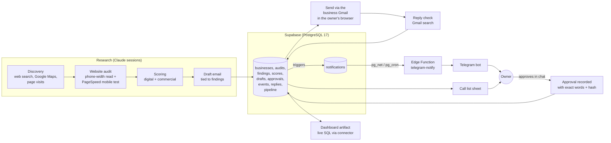

# Architecture

## Components

| Component | Technology | Notes |
|---|---|---|
| Database / CRM | Supabase (PostgreSQL 17) | 26 tables, RLS on all; 17-stage `pipeline_stage` enum |
| Research and drafting | Claude sessions | Browser page reads and PageSpeed tests |
| Website speed | pagespeed.web.dev (public page) | A free PageSpeed API key would allow unattended runs |
| Discovery | Web search, Google Places search (place ID stored only), page visits | Places API (New) key not set up |
| Sending | Gmail web, the agency's business mailbox | Fingerprint check before every send |
| Alerts | Edge Function `telegram-notify` + `pg_net` + `pg_cron` (5-minute sweep) | Secret header kept in Vault; token in Edge Function secrets |
| Dashboard | Claude artifact | Live queries through the viewer's Supabase connector |
| Call list | Claude sheet | Tabs: Call list, No-website leads, Notes, Call script |

## Main tables (migration 0001)
businesses, business_locations, business_contacts, social_profiles, website_audits, audit_findings, competitor_research, digital_scores, commercial_scores, outreach_drafts, outreach_approvals, outreach_events, consent_records, suppression_list, incoming_replies, sales_pipeline, meetings, proposals, notifications, workflow_runs, integration_logs, staff_members, kenya_counties, audit_log and supporting tables.

## Guards enforced in the database
- A send cannot be recorded unless a staff member approved that exact draft version, the contact is eligible, and neither business nor address is suppressed.
- Approvals are append-only and snapshot the approved text.
- Duplicate businesses (same domain or Google place ID) are refused.
- Source-restricted data carries an expiry and is purged.

## Planned (Phase 4, not built)
Supabase scheduled functions calling the Claude API for unattended discovery, audits and drafting; a Gmail connector on the business mailbox for automatic reply classification; an approval centre with approve / reject / rewrite buttons.
